# Rapport d'usage de l'IA — TP1, TP2 et TP3

## TP1 — Architecture, authentification et profil

**Architecture, authentification et profil — 30 septembre et 1er octobre 2026**

**Outil :** Codex avec VS Code. **Modèle déclaré par l'étudiant :** GPT-6 Astra, effort minimal.

Ce rapport suit l'ordre de `SUJET_ETUDIANT_TP1.md`. Le carnet personnel de compréhension reste séparé dans `RAPPORT_SUIVI_TP1.md`.

### 1. Préparation

Le backend a été configuré avec MongoDB Atlas et un `.env` local ignoré par Git. GET `/api/health` a répondu `{"status":"ok"}`. Le frontend utilise un proxy vers `http://localhost:3000`, avec `secure: false`. La connexion, l'import et la lecture d'un audio ont été observés pendant la préparation.

**Où voir les traces backend ?** Dans le terminal où le serveur tourne depuis `backend`. La console du navigateur contient les traces frontend ; Network montre les échanges HTTP.

### 2. Mission 0 — Cartographier l'application

#### Objectif et utilisation de l'IA

Identifier les responsabilités du code fourni, produire un schéma et distinguer les routes publiques/protégées, sans modifier le code au début.

**Demande reformulée :** « Résumer les fichiers demandés et leurs rôles, produire ensuite un schéma de connexion, puis identifier les routes API. »

L'assistant a lu les sources et le contrat API puis proposé les explications et le schéma. L'étudiant a exploré l'arborescence dans VS Code et demandé le respect de l'ordre du sujet. Aucun changement applicatif n'a été réalisé pour cette mission.

#### Cartographie

Les chemins Angular partent de `frontend-starter/src/`.

| Élément | Fichier | Rôle |
| --- | --- | --- |
| Composant racine | `app/components/app/app.ts` et `app.html` | Navigation et router-outlet pour la page active. |
| Routes | `app/routes.ts` | Association URL/composant ; garde sur profile et tracks. |
| HttpClient | `main.ts` | Enregistrement par `provideHttpClient(withInterceptors([authInterceptor]))`. |
| Modèles | `app/shared/models/` | User, AuthResponse, Track, Page : types des données. |
| Services | `app/shared/services/auth.service.ts`, `track.service.ts` | Appels API, état utilisateur et opérations audio. |
| Pages | `app/components/*-page/` | Formulaires, interaction et affichage. |
| Ajout du JWT | `app/shared/interceptors/auth.interceptor.ts` | En-tête Authorization sur les appels protégés. |
| Garde | `app/shared/guards/auth.guard.ts` | Test de présence du token avant navigation. |

#### Schéma annoté

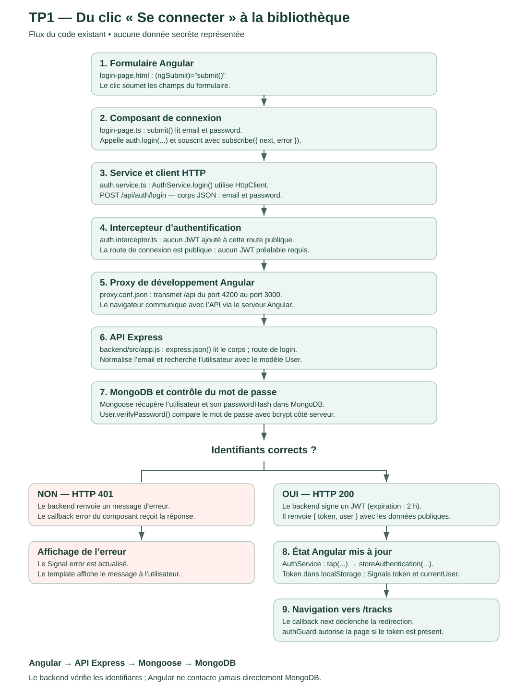

**Figure 1 —** Schéma établi par lecture du code, actualisé après la mission 1 pour refléter le filtrage de l'intercepteur. Il décrit le programme et ne constitue pas une capture Network.

Le formulaire appelle le composant, qui valide puis sollicite AuthService. HttpClient envoie le POST ; le proxy le transmet à Express. Le backend recherche l'utilisateur avec Mongoose et compare le mot de passe au hash avec bcrypt. En cas de succès, il renvoie `{ token, user }` ; le service stocke le token et actualise les Signals avant la redirection vers `/tracks`. En cas d'échec, le serveur répond 401 et le formulaire affiche un message. Angular ne contacte jamais directement MongoDB.

#### Vérification et recul critique

Le flux a été vérifié par lecture croisée des composants, du service, de `backend/src/app.js` et de `backend/src/models/User.js`. Les routes de la section 4 ont été confrontées au contrat et aux middlewares Express.

L'étudiant a corrigé une progression proposée trop tôt par l'IA pour terminer la préparation avant les missions. Deux nuances ont été identifiées : health est également public ; l'intercepteur initial ne filtrait pas les destinations du JWT. Ce dernier point a été corrigé en mission 1. La garde Angular ne remplace pas la vérification du JWT côté serveur.

**Productions :** schéma SVG, notes de suivi et entrée de rapport. Cette mission documentaire n'a pas nécessité de test automatisé spécifique.

### 3. Mission 1 — Inscription, connexion et profil

#### Objectif et démarche avec l'IA

Compléter la partie utilisateur en séparant composant, service et API, avec `inject()` et sans HttpClient directement dans les composants.

**Demandes, synthèse des échanges :** compléter les tirets dans l'ordre, expliquer les changements et les fichiers, commenter les ajouts, fournir les tests et les preuves utiles au rendu. Cette synthèse n'est pas une transcription littérale.

L'assistant a inspecté l'existant, appliqué les modifications autorisées, compilé et contrôlé la logique. L'étudiant a lancé l'application, réalisé des essais, signalé les erreurs et fourni les captures.

#### Réalisations dans l'ordre du sujet

| Tiret | Travail et fonctionnement |
| --- | --- |
| 1. Formulaires réactifs | FormGroup, FormControl et ReactiveFormsModule existants réutilisés pour login/register. |
| 2. Validations et messages | Longueurs minimales issues du backend, erreurs par champ, blocage des formulaires invalides, état pending et messages HTTP compréhensibles ajoutés. |
| 3. Appels register/login | Méthodes POST existantes d'AuthService conservées, avec données du formulaire et réponse AuthResponse. |
| 4. Sauvegarde du JWT | Mécanisme existant : gpc_token dans localStorage et Signal token ; aucune valeur de JWT ajoutée aux logs. |
| 5. currentUser | Le tap existant actualise le Signal après authentification, lecture ou modification du profil. |
| 6. Redirections | Callbacks existants : login vers /tracks et inscription vers /profile, après enregistrement de la session. |
| 7. Déconnexion | Bouton ajouté au composant racine ; logout vide stockage et Signals, puis navigation /login. |
| 8. Lecture du profil | GET automatique dans ngOnInit, attente/erreur, bouton d'actualisation et préremplissage du nom. |
| 9. Modification du nom | Validation après trim, PUT via le service, état saving, succès et erreurs. Le nom affiché vient de la réponse serveur. |
| 10. Gestion du 401 | Filtrage des API protégées, nettoyage et retour /login?session=expired. Les erreurs login restent locales ; une réponse tardive ne déconnecte pas une nouvelle session. |

**Fichiers complétés**, sous `frontend-starter/src/app/` : TS et HTML de `components/register-page`, `login-page`, `profile-page`, `app`, ainsi que `shared/interceptors/auth.interceptor.ts` — neuf fichiers. Des commentaires expliquent les ajouts. AuthService et les routes backend nécessaires existaient déjà et ont été réutilisés.

#### Vérifications, difficultés et limites

- Les builds `npm.cmd run build` ont réussi pendant le développement ; les contrôles de diff ciblés n'ont pas signalé d'erreur de format.
- Sept cas simulés de l'intercepteur ont réussi : succès protégé, 401 protégé, 401 login, 409 register, requête externe, 500 protégé, 401 tardif après renouvellement. Contrôle en mémoire avec services simulés, sans appel serveur ni fichier de test permanent.
- Les captures attestent login 200, login 401 et GET profil 200. La liste montre également register 201/409.
- Un 502 a été rencontré pendant l'échec de connexion du backend à Atlas. L'étudiant a ensuite confirmé le rétablissement ; la correction exacte n'a pas été consignée.
- Les tests navigateur détaillés de déconnexion, PUT du nom, persistance après F5 et token invalide restent à confirmer. La compilation seule ne les prouve pas.

**Recul critique :** les fonctionnalités déjà fournies ont été distinguées des ajouts. Les règles ont été vérifiées dans le backend. Le filtrage du JWT et la distinction entre 401 de connexion et 401 de session ont été explicités. Une proposition de test n'a pas été présentée comme un résultat observé.

### 4. Réponses aux questions

#### Quel modèle a été utilisé ?

Pour ce TP, l'étudiant indique avoir utilisé **GPT-6 Astra, effort minimal, dans Codex**.

#### Comment connaître la consommation ?

Le suivi utilisé par l'étudiant est **Paramètres → Quota**, affiché en pourcentage. Ce pourcentage mesure l'utilisation du quota, pas à lui seul un nombre exact de tokens. Aucun total exact de tokens n'a été relevé pour ce TP.

#### Qui peut conseiller un modèle adapté ?

On peut consulter les documentations et comparaisons sur Internet, en vérifiant leur date et leur source, ou demander conseil à l'IA selon la difficulté de la tâche. La qualité obtenue, le coût et la rapidité permettent ensuite de juger le choix ; le conseil de l'assistant doit être vérifié.

#### Quelles routes backend sont utilisées ?

| Méthode | Route | Accès | Fonction |
| --- | --- | --- | --- |
| GET | `/api/health` | Public | Contrôle du serveur |
| POST | `/api/auth/register` | Public | Inscription |
| POST | `/api/auth/login` | Public | Connexion |
| GET | `/api/users/me` | JWT | Lecture profil |
| PUT | `/api/users/me` | JWT | Modification nom |
| GET | `/api/tracks?page=1&limit=5` | JWT | Liste paginée |
| POST | `/api/tracks` | JWT | Import audio multipart/form-data |
| GET | `/api/tracks/:id/audio` | JWT | Récupération audio |
| DELETE | `/api/tracks/:id` | JWT | Bonus disponible au backend, non ajouté au frontend dans ce TP |

La méthode distingue les opérations sur un même chemin. Le middleware Express auth contrôle la signature et l'expiration du JWT des routes protégées.

#### Où s'effectue la mise à jour du profil ?

**Frontend :** `frontend-starter/src/app/components/profile-page/profile-page.html` soumet le formulaire à `save()` dans `profile-page.ts`. Ce composant valide puis appelle `update()` de `frontend-starter/src/app/shared/services/auth.service.ts`. Le service envoie PUT `/api/users/me` avec `{ name }` ; `auth.interceptor.ts` ajoute Authorization.

**Backend :** `backend/src/app.js` vérifie le JWT puis appelle `User.findByIdAndUpdate(req.auth.sub, ...)`. L'identité vient du token. `new: true` renvoie le document modifié ; `runValidators: true` applique les contraintes de `backend/src/models/User.js`. Mongoose réalise l'écriture MongoDB. Le serveur renvoie les données publiques ; le service Angular actualise currentUser et donc l'affichage.

### 5. Checkpoint Network

Les trois captures ont été examinées : aucune valeur réelle de mot de passe, JWT ou URI MongoDB n'y est visible.

#### 1 — Connexion réussie

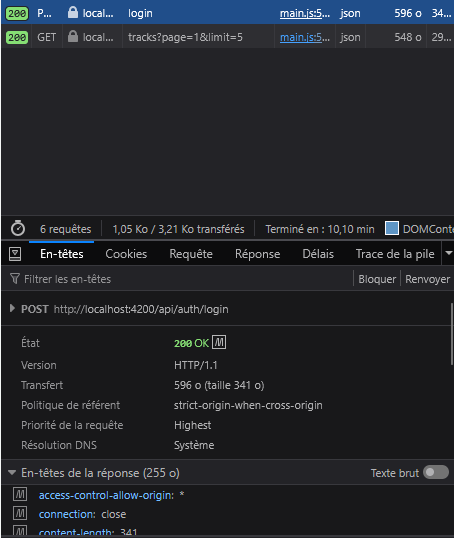

**Figure 2 —** POST `http://localhost:4200/api/auth/login`, **200 OK**. Les requêtes suivantes de liste des pistes sont visibles.

#### 2 — Connexion refusée

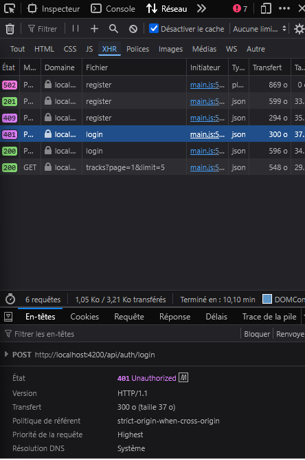

**Figure 3 —** POST `http://localhost:4200/api/auth/login`, **401 Unauthorized**. La liste contient aussi des essais register 201/409 et un ancien 502 ; ce sont des requêtes différentes.

#### 3 — Lecture du profil

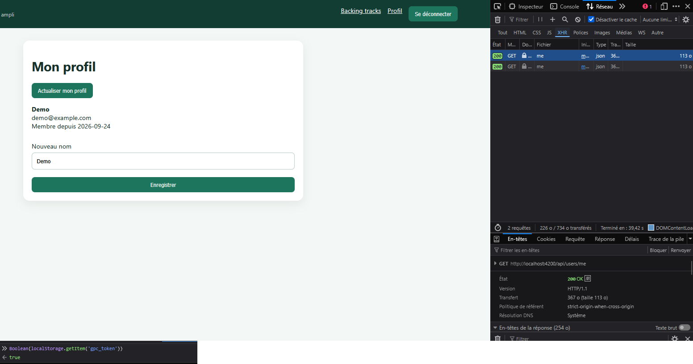

**Figure 4 —** GET `http://localhost:4200/api/users/me`, **200 OK**, profil affiché et nom prérempli. Le booléen de présence du stockage n'expose pas le JWT. Cette lecture satisfait le cas « lecture ou modification ».

#### Relevé des échanges

Les méthodes, URL et statuts sont visibles. Les corps, formes de réponse et règles Authorization ci-dessous viennent du code/contrat : ces détails ne sont pas tous dépliés dans les captures. Les valeurs sensibles ne sont pas reproduites.

| Cas | Méthode et URL navigateur | Corps JSON masqué | Statut observé | Réponse prévue par le backend | Authorization dans le code final |
| --- | --- | --- | --- | --- | --- |
| Login réussi | POST `http://localhost:4200/api/auth/login` | `{"email":"[compte test]","password":"[MASQUÉ]"}` | 200 | `{ token, user }`, token non reproduit | Non ajouté : public |
| Login refusé | POST `http://localhost:4200/api/auth/login` | `{"email":"[compte test]","password":"[MASQUÉ]"}` | 401 | `{"message":"Identifiants incorrects"}` | Non ajouté : public |
| Profil | GET `http://localhost:4200/api/users/me` | Aucun | 200 | `{ id, name, email, createdAt }` | Oui, Bearer, valeur non reproduite |

Pour compléter l'observation exhaustive demandée, vérifier aussi Requête/Réponse et les en-têtes lors d'un essai. Relever les noms de champs et la présence d'Authorization sans copier les valeurs secrètes. Les captures actuelles ne prouvent pas visuellement tous ces détails.

### 6. Livrables — Dans l'ordre du sujet

#### 1 — Code frontend complété

Les neuf fichiers de la section 3 constituent l'implémentation. Compilation réussie ; preuves et limites de validation précisées ci-dessus.

#### 2 — Schéma annoté du flux de connexion

Figure 1, source : [schema-connexion.svg](docs/images/tp1/mission-0/schema-connexion.svg).

#### 3 — Capture Network d'authentification

Figures 2 et 3 : connexion réussie et refusée. La figure 4 complète le checkpoint avec le profil.

#### 4 — Signal et localStorage

Un **Signal** garde une valeur réactive en mémoire : Angular actualise l'interface lorsqu'elle change. Il est recréé après rechargement. **localStorage** conserve des chaînes entre rechargements sur la même origine, sans actualiser automatiquement les Signals. Ici le JWT est conservé dans localStorage puis relu dans le Signal token ; currentUser est restauré par l'API au chargement du profil.

#### 5 — Usage de l'IA par mission

Les sections 2 et 3 consignent objectifs, demandes, démarche, rôles, fichiers, vérifications et recul critique. Les figures fournissent les preuves disponibles. Chaque membre doit pouvoir expliquer sans assistance la connexion, le PUT profil et la différence entre garde, intercepteur et contrôle serveur ; ce rapport ne constitue pas une évaluation de cette maîtrise individuelle.

---

## TP2 — Bibliothèque, upload et lecture audio

Travail réalisé le 7 octobre 2026 avec l'aide de l'assistant : analyse du starter, implémentation, commentaires par bloc, tests dans l'application locale et rédaction du rapport. Les captures automatiques proviennent de la vraie application sur `localhost:4200`, ouverte dans une session Edge séparée. Les essais sont attribués à l'assistant ; la compréhension personnelle se prépare avec le suivi TP2.

### Mission 2 — Bibliothèque paginée

#### Fonctionnement et intervention

Le starter fournissait `TrackService.list(page, limit)`. Le composant conserve des Signals pour `tracks`, `page`, `pages`, `loading` et l'erreur ; `@if`, `@for` avec suivi par id et `@empty` affichent les états correspondants. Chaque navigation appelle le serveur. Aucun découpage local de toute la bibliothèque n'est réalisé.

L'assistant a complété la gestion d'erreur et des bornes, puis intégré Material. Une ancienne requête est annulée pour éviter qu'elle remplace la page actuelle.

#### Avancé — Angular Material

`MatPaginator` remplace les boutons initiaux. Il reçoit le total du serveur et propose 5, 10 ou 20 morceaux par page. Son événement `PageEvent` fournit un index commençant à zéro : le composant ajoute 1 pour l'API, puis recharge la liste avec la taille choisie. Les libellés sont traduits avec `MatPaginatorIntl`, les boutons sont désactivés aux bornes et pendant le chargement. [Documentation Material](https://material.angular.dev/components/paginator/overview).

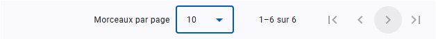

Cette capture montre le total et le choix de taille. Les tests ont vérifié des requêtes réelles avec page 2 / limite 5, puis limite 10.

#### Avancé — Pagination Mongoose

Le plugin `aggregate-paginate-v2`, explicitement facultatif dans le sujet, n'a pas été ajouté. La pagination serveur fournie avec `skip`, `limit` et `countDocuments` est conservée.

### Mission 3 — Upload et lecture audio

#### 1. Repérer le flux existant

| Opération | Fichier et méthode |
| --- | --- |
| Choix du fichier | `tracks-page.html` et `TracksPageComponent.choose()` |
| FormData et upload | `track.service.ts`, `upload()` : champs `audio` et `title` |
| Récupération du Blob | `TrackService.audio()` : `responseType: 'blob'` |
| Création de l'ObjectURL | Callback de `play()` dans `tracks-page.ts` |
| Lecteur | `tracks-page.html`, `<audio [src]="audioUrl()">` |
| Révocation | `releaseAudio()` au remplacement et via `DestroyRef` à la destruction |

Upload : composant → service → HttpClient → Express/Multer → disque et MongoDB. Lecture : API → Blob → ObjectURL → lecteur audio. Le mécanisme existant a été complété.

#### 2. Authentification de l'audio

`auth.interceptor.ts` ajoute le header JWT aux appels API de HttpClient, dont la lecture audio. Une URL HTTP directement placée dans `src` serait demandée par le navigateur sans passer par cet intercepteur. Elle ne recevrait donc pas automatiquement le header Authorization de l'application.

#### 3. Validation backend et frontend

Dans `backend/src/app.js`, Multer contrôle le type et la limite de 25 Mo ; `upload.single('audio')` traite le champ fichier, la route exige sa présence et lit `title`. Angular construit les deux champs attendus.

Le frontend vérifie présence, fichier non vide, MIME autorisé et taille avant HTTP. Le refus local évite un transfert inutile ; il ne remplace pas le backend, car un client modifié peut contourner Angular. Un fichier refusé localement ne génère pas de réponse HTTP 400.

#### 4. États d'envoi

Le formulaire réactif utilise `FormGroup` pour `ngSubmit`. Pendant l'envoi : état de chargement, verrouillage des contrôles et garde contre les doubles soumissions. Au succès : confirmation, formulaire vidé, retour page 1. En cas d'erreur : message et saisie conservée pour réessayer.

#### 5. Cards et lecture

Les cards affichent titre, fichier, format, taille, date et actions. Elles s'adaptent aux petits écrans avec labels, focus clavier et messages annoncés. Le morceau sélectionné est distingué d'une lecture effective par les événements du lecteur. Les erreurs HTTP et de décodage sont affichées ; les souscriptions et ObjectURL sont nettoyées au changement et à la destruction.

#### 6. Questions sur mémoire, buffering et streaming

1. **Le backend charge-t-il le fichier entier en mémoire ?** La route utilise `res.sendFile` depuis le disque. Elle peut transmettre progressivement avec des tampons internes, sans charger explicitement tout l'audio dans un Buffer JavaScript. Cela ne garantit pas une lecture immédiate côté Angular.
2. **Quand HttpClient fournit-il le Blob ?** En observant le corps avec `responseType: 'blob'`, le composant reçoit généralement le Blob lorsque la réponse complète a été téléchargée. Il crée ensuite l'ObjectURL. Les événements de progression ajoutés concernent ici l'upload, pas une lecture audio progressive. [Documentation Angular](https://angular.dev/guide/http/making-requests).
3. **100 morceaux chargent-ils 100 fichiers audio ?** Non. `list()` reçoit les métadonnées d'une page ; `audio(id)` n'est appelé que par `play()` après le choix d'un morceau. Une seule ObjectURL audio est conservée. Les images des cards visibles sont des ressources distinctes, chargées uniquement pour la page affichée.
4. **Et avec 100 éléments audio utilisant des URL HTTP ?** Le navigateur pourrait demander des métadonnées ou du contenu selon `preload` et ses décisions. Cela ne signifie pas forcément 100 téléchargements complets immédiats, mais multiplie les lecteurs et les ressources possibles. Ces demandes ne passent pas par notre intercepteur JWT. [Documentation audio](https://developer.mozilla.org/en-US/docs/Web/HTML/Reference/Elements/audio).
5. **Pourquoi révoquer l'ObjectURL ?** Elle maintient une référence au Blob. `URL.revokeObjectURL` retire cette référence lorsqu'elle n'est plus utilisée, pour permettre la libération des ressources. Le moment précis de récupération mémoire reste géré par le navigateur. L'URL reste valide pendant la lecture. [Documentation des URL blob](https://developer.mozilla.org/en-US/docs/Web/URI/Reference/Schemes/blob).

Le streaming serveur est l'envoi progressif ; le buffering est la mise en tampon pour lire/décoder ; notre lecteur reçoit un Blob complet avant d'être alimenté.

### Améliorations demandées

#### Barre de progression

`withXhr()` active les événements d'upload. `TrackService.upload()` observe les événements avec `reportProgress: true`. Le composant calcule `loaded / total` pour le `<progress>` ; sans total, l'indicateur est indéterminé. À 100 %, il attend encore la réponse confirmant l'enregistrement. L'envoi de la couverture est indiqué séparément. [Documentation XHR Angular](https://angular.dev/api/common/http/withXhr).

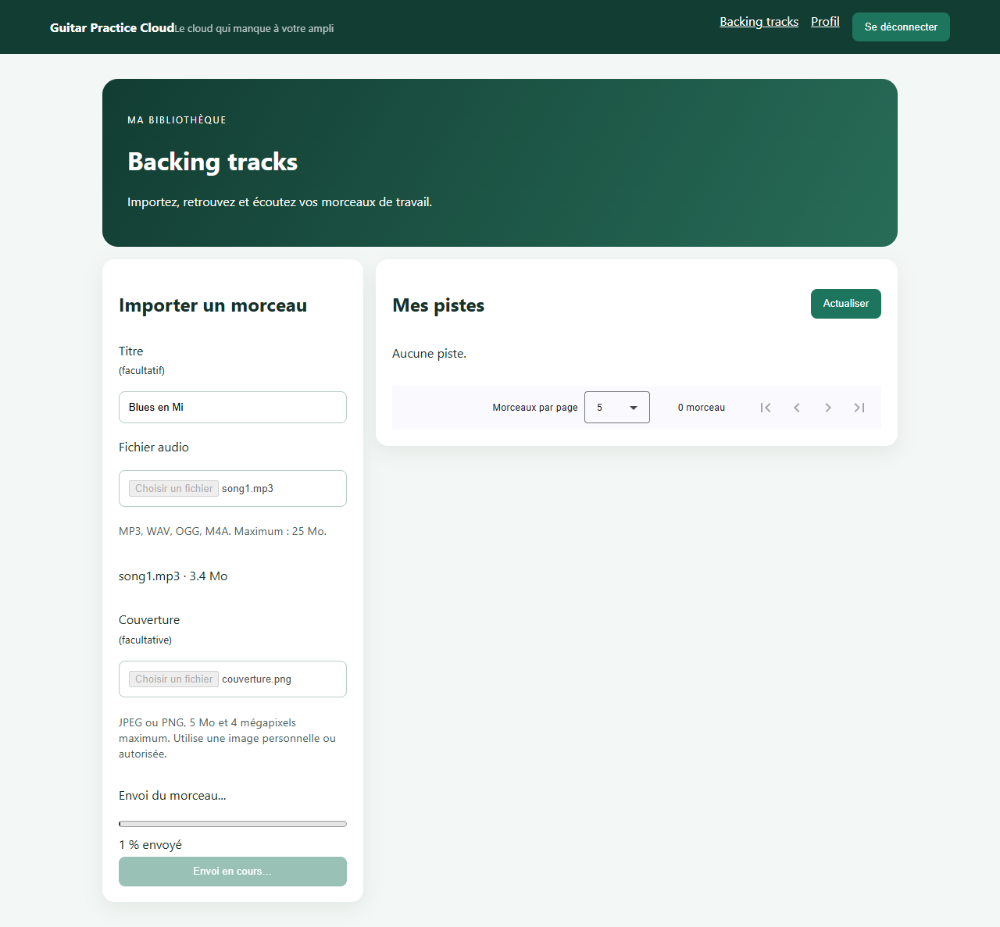

La capture a été prise pendant un transfert réel ralenti dans le navigateur de test ; le pourcentage n'est pas simulé.

#### Suppression avec confirmation et rafraîchissement

Un dialogue Material explique que l'audio et la couverture seront supprimés définitivement. Annuler, Échap ou fermer ne déclenche aucun DELETE. Seule la confirmation appelle `TrackService.remove()` ; le serveur vérifie le propriétaire et répond 204. Pendant l'attente, les actions concurrentes sont bloquées. Après succès, le lecteur du morceau supprimé est arrêté et la liste rechargée. Si la dernière page devient vide, le composant revient à la dernière page existante.

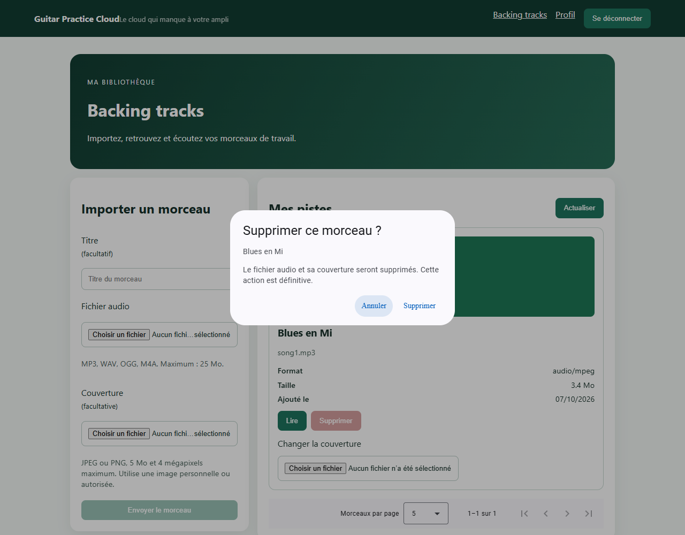

La capture montre la décision avant l'appel HTTP. Les essais ont vérifié annulation sans DELETE, refus 404 pour un autre compte et suppression réelle avec nettoyage des fichiers.

Le formatage de taille et de date est également réalisé. Le filtre par titre n'a pas été ajouté.

### Avancé — Image de couverture

#### Conception des données et de l'API

L'approche retenue est l'upload d'une image personnelle ou autorisée. Avant implémentation, les besoins ont été identifiés : métadonnées supplémentaires, stockage privé, accès propriétaire, validation, remplacement et suppression du fichier. Le contrat est décrit dans `API_CONTRACT.md`.

- MongoDB : `coverStoredName` privé et `coverUpdatedAt` public, sans casser les pistes anciennes.
- PUT `/api/tracks/:id/cover` : un fichier multipart `cover`, JWT propriétaire, réponse 200 Track.
- GET `/api/tracks/:id/cover` : JWT propriétaire, JPEG privé ; 401 sans token et 404 pour une piste interdite ou une couverture absente.
- Le POST audio conserve exactement `audio` et `title`. La couverture est envoyée ensuite, puis peut être ajoutée/remplacée depuis une card.
- JPEG/PNG, 5 Mo et 4 millions de pixels maximum. Le serveur vérifie et décode le contenu, réduit à 800 pixels et réencode en JPEG sans métadonnées d'origine. SVG n'est pas accepté.
- Les images affichées viennent de HttpClient authentifié ; les ObjectURL sont révoquées à la navigation et à la destruction. L'image décorative utilise un `alt` vide, avec le titre de la piste à proximité.

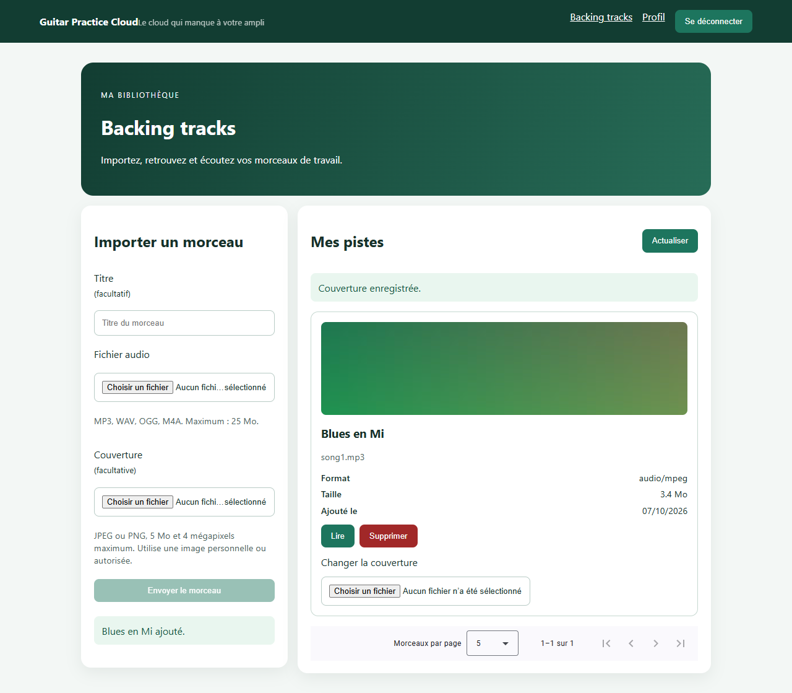

L'image de démonstration est un motif de couleurs créé pour les essais, sans image tierce. La recherche Web et l'extraction ID3 constituent l'autre approche possible ; elles n'ont pas été implémentées.

#### Difficultés et limites

Windows a bloqué le module natif Sharp. Il a été retiré et remplacé par `jpeg-js` et `pngjs`. Les tests couvrent le faux JPEG, la taille, les dimensions, la propriété et le remplacement. La conversion est synchrone et bornée : pour une application à fort trafic, elle devrait être isolée dans des workers. L'orientation EXIF des photos n'est pas appliquée automatiquement ; les métadonnées ne sont pas conservées.

L'upload audio et l'upload image sont deux opérations : si l'image échoue, l'audio reste disponible et l'interface permet de réessayer depuis sa card. Le nettoyage disque n'est pas une transaction avec MongoDB ; un échec est journalisé et signalé.

### Checkpoint Network — Dans l'ordre du sujet

| Vérification demandée | Résultat et preuve |
| --- | --- |
| Changer la page modifie `page` | GET réels page 1 puis 2, limite 5 ; choix limite 10 également vérifié. |
| Upload multipart `audio` et `title` | Upload réel 201 avec ces deux champs, puis PUT séparé pour `cover`. |
| Réponse de lecture audio | GET 200, Content-Type audio/mpeg et lecture effective dans le navigateur. |
| Erreur 400 pour fichier invalide | Le vrai serveur refuse un multipart text/plain. L'affichage 400 est attesté par la capture de mission 3 ; les refus locaux sans HTTP ont aussi été vérifiés. |
| Piste lisible seulement par son propriétaire | GET audio 404 depuis un autre compte doté d'un JWT valide ; 200 pour le propriétaire. |

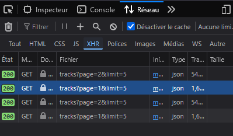

Cette capture a été fournie par l'étudiant. Les nouveaux échanges ont été observés dans le navigateur automatisé, sans conserver de JWT.

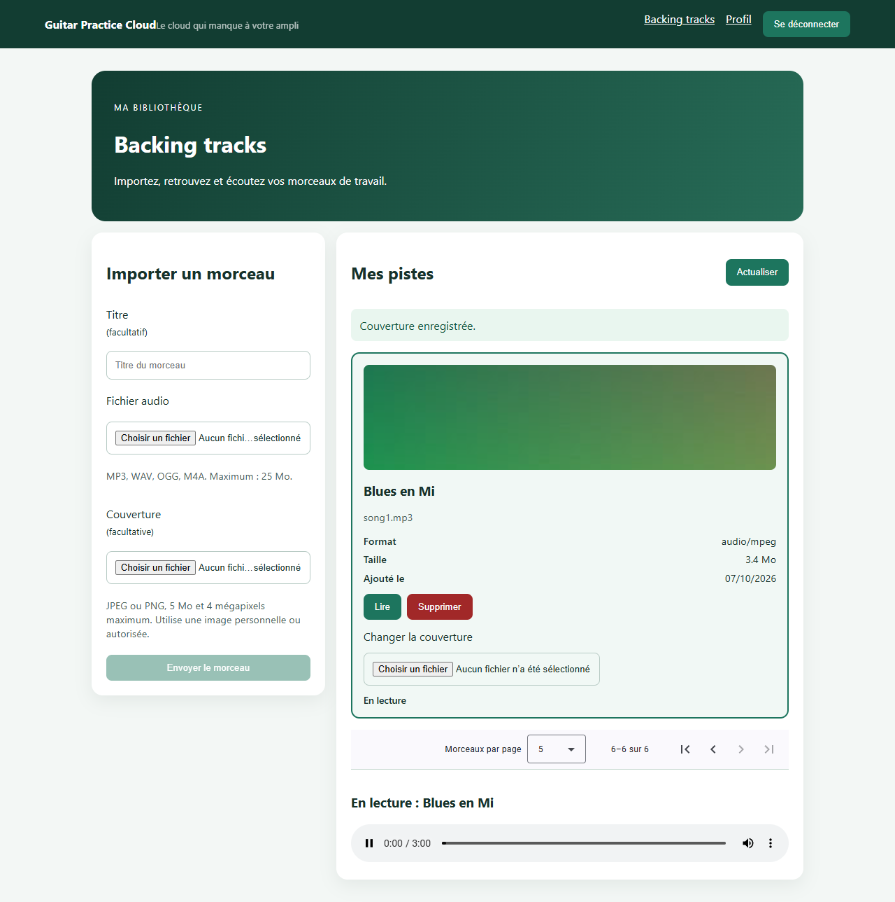

Cette image montre le lecteur et la piste. La présence d'Authorization et les statuts HTTP ont été vérifiés séparément ; ils ne sont pas visibles dans cette image.

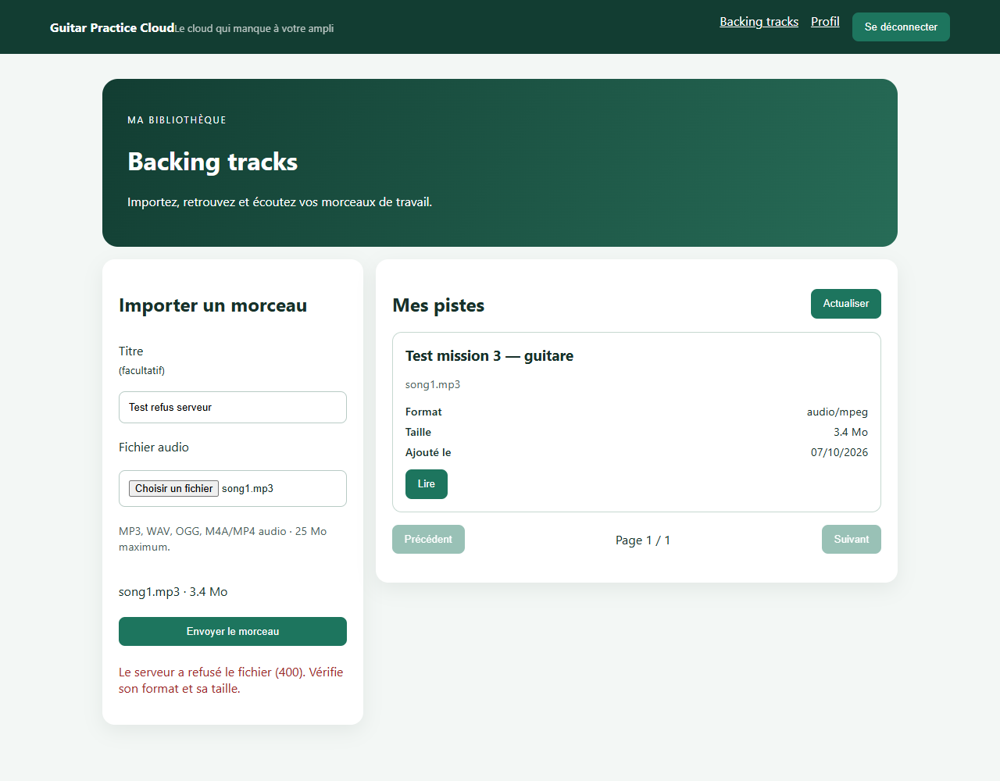

Cette preuve antérieure vient d'un vrai refus backend après modification du MIME multipart dans le navigateur de test. Elle montre la conservation de la saisie. Les textes et cards ont été simplifiés depuis.

### Livrables TP2 — Dans l'ordre du sujet

| Livrable | Contenu fourni |
| --- | --- |
| Code frontend complété | Pagination Material, upload validé avec progression, suppression confirmée, couverture et lecture authentifiée ; contrat de l'extension documenté. |
| Cards lisibles | Captures de couverture desktop et [vue mobile](docs/images/tp2/extensions/mobile-material.png). |
| Capture Network pagination ou upload | Capture de pagination ci-dessus. |
| Capture ou démonstration de lecture authentifiée | Capture de lecture ci-dessus ; GET propriétaire 200 et autre compte 404 vérifiés. |
| Explication Blob et ObjectURL | HttpClient transmet le JWT, reçoit le Blob et fournit une URL locale au lecteur ; révocation au remplacement et à la destruction. |
| Réponses mémoire, buffering et streaming | Cinq réponses dans la mission 3, dans l'ordre des questions. |

#### Vérification et recul sur l'aide reçue

`npm.cmd run build` réussit et les deux tests backend fournis passent. La campagne navigateur a terminé ses 10 groupes de contrôles : transfert, couverture, validation serveur, remplacement, checkpoint, pagination, lecture/annulation, suppression et mobile. Un contrôle final vérifie aussi un PNG corrompu refusé en 400, l'annulation par Échap et l'affichage d'un DELETE 500 simulé sans disparition de la card. Ce dernier 500 est une simulation d'interface, distincte des échanges réels.

Les comptes, pistes et scripts temporaires de cette nouvelle campagne sont supprimés après les essais ; seules les six captures et ce bilan restent. Les anciennes captures de mission 3 sont conservées comme preuves historiques. L'installation a signalé des alertes de dépendances : les correctifs compatibles de Multer/proxy-addr ont été appliqués (audit backend : 0). L'audit frontend hors dépendances de développement conserve une alerte concernant le routeur Angular et le rendu SSR, qui n'est pas utilisé dans ce projet ; aucune mise à jour générale d'Angular n'est revendiquée.

Les commentaires expliquent les blocs de code. Le rapport de suivi détaille les méthodes et les tests à reproduire ; il reste nécessaire de pouvoir reformuler le flux personnellement, sans attribuer les tests automatiques à l'étudiant.


## TP3 — Fiabilisation et enrichissement du frontend

Travail réalisé les 14 et 15 octobre 2026. Cette partie suit l'ordre de `SUJET_ETUDIANT_TP3.md`. Les développements détaillés de préparation à l'oral sont conservés dans le suivi personnel, séparé du rendu.

### 1. Prérequis et utilisation de l'IA

Le contrat `API_CONTRACT.md` a été relu. La suppression confirmée et la progression existaient déjà à la fin du TP2 : elles ont été reprises et vérifiées, sans les présenter comme entièrement nouvelles. Les routes backend n'ont pas été modifiées pour les missions obligatoires du TP3.

**Outil utilisé :** Codex. Le modèle exact utilisé pour cette partie n'a pas été relevé ; la déclaration du TP1 ne constitue pas une mesure pour le TP3.

**Demandes reformulées :** suivre les missions dans l'ordre, expliquer les fichiers et commenter les ajouts, utiliser SnackBar, vérifier la progression, ajouter des tests ciblés sans remplacer l'existant, puis conserver les preuves demandées. L'assistant a proposé et modifié le code autorisé, exécuté les tests et produit les captures d'interface. L'étudiant a discuté les choix, réalisé les vérifications Network finales et fourni leurs captures.

### 2. Mission 5 — Suppression d'une piste

#### Composant, service et réalisation

Le composant concerné est `frontend-starter/src/app/components/tracks-page/tracks-page.ts`, avec son template `tracks-page.html`. Il appelle `remove(id)` dans `frontend-starter/src/app/shared/services/track.service.ts`. Le composant ne contacte pas directement HttpClient.

| Exigence | Réalisation |
| --- | --- |
| Action Supprimer dans chaque card | Bouton associé à la piste, présent depuis le TP2. |
| Confirmation | `confirmDelete()` ouvre `DeleteDialogComponent`. Annuler ne déclenche aucun DELETE. |
| État de suppression | `deleting()` bloque les actions répétées pendant la requête. |
| Succès ou erreur avec Angular SnackBar | Ajout de MatSnackBar et de `notify()`. Le succès 204 affiche « Morceau supprimé. ». |
| Mise à jour de la page | `load()` recharge la liste après le résultat ; les bornes de pagination sont recalculées. |
| Piste absente ou appartenant à un autre compte | Le 404 affiche un message de ressource indisponible puis recharge la liste. Le serveur ne révèle pas lequel des deux cas s'est produit. |

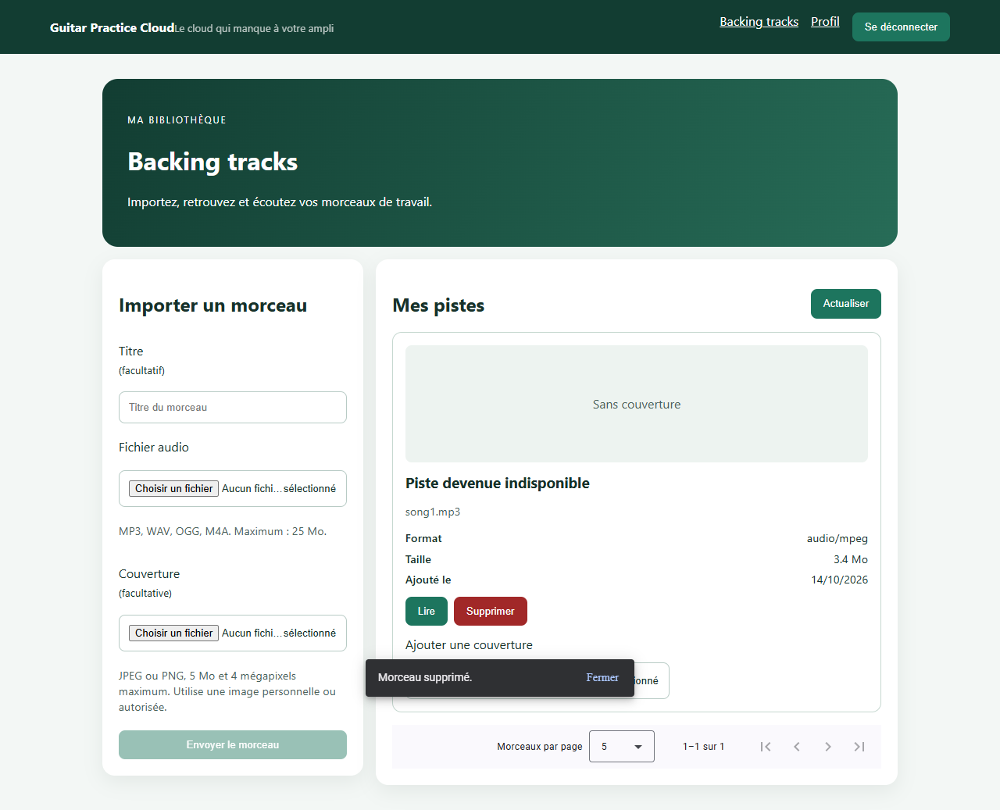

Cette capture d'interface montre le retour après suppression. L'essai automatisé sur un compte temporaire a observé DELETE 204 puis la disparition de la piste.

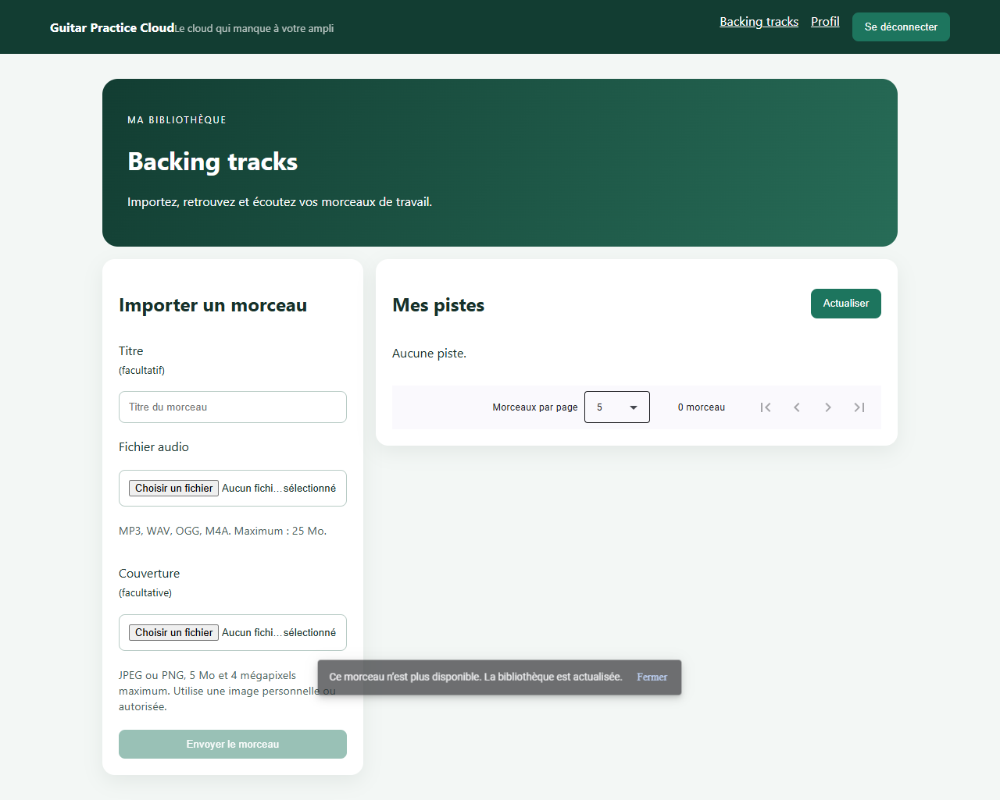

Pour cet essai, la piste a été supprimée par une autre requête après ouverture du dialogue. Le DELETE de l'interface a reçu 404 ; le message et le rechargement ont été vérifiés. Les données temporaires ont ensuite été supprimées.

#### Pourquoi le guard et l'interface ne suffisent-ils pas à sécuriser la suppression ?

Le guard contrôle la navigation dans Angular et les boutons guident l'utilisateur. Ils s'exécutent sur son appareil et peuvent être contournés en envoyant une requête HTTP directement. Dans `backend/src/app.js`, le middleware `auth` vérifie la signature et l'expiration du JWT. La suppression utilise ensuite `Track.findOneAndDelete({ _id: req.params.id, ownerId: req.auth.sub })` : la piste doit appartenir à l'utilisateur identifié par le token. Un JWT absent ou invalide produit 401 ; une piste absente ou interdite produit 404. C'est ce contrôle serveur qui fait autorité.

### 3. Mission 6 — Progression de l'upload

La fonctionnalité existait au TP2. Le TP3 a ajouté des commentaires explicatifs dans `track.service.ts` et `tracks-page.ts` et des preuves ciblées.

- Au repos : pas de progression affichée.
- Pendant l'envoi : `uploading()` active l'attente, les champs concernés sont bloqués et une seconde soumission est refusée.
- Progression : `Math.round(100 * loaded / total)` ; sans total connu, indicateur indéterminé.
- Réussite : seule la réponse finale confirme la création, vide le formulaire et recharge la liste.
- Échec : message adapté, fin de l'attente et conservation de la saisie pour réessayer.

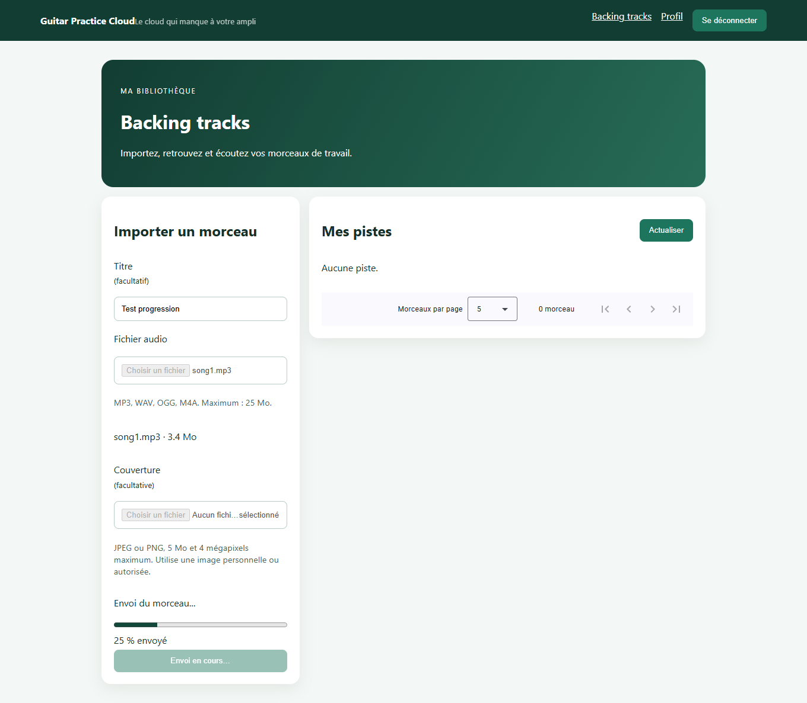

Le transfert réel a été ralenti dans la session de navigateur automatisée. Le double envoi a été bloqué. Le POST s'est terminé avec le statut 201 ; le formulaire vidé et la piste créée sont visibles dans la [capture de succès](docs/images/tp3/mission6/upload-reussi.png).

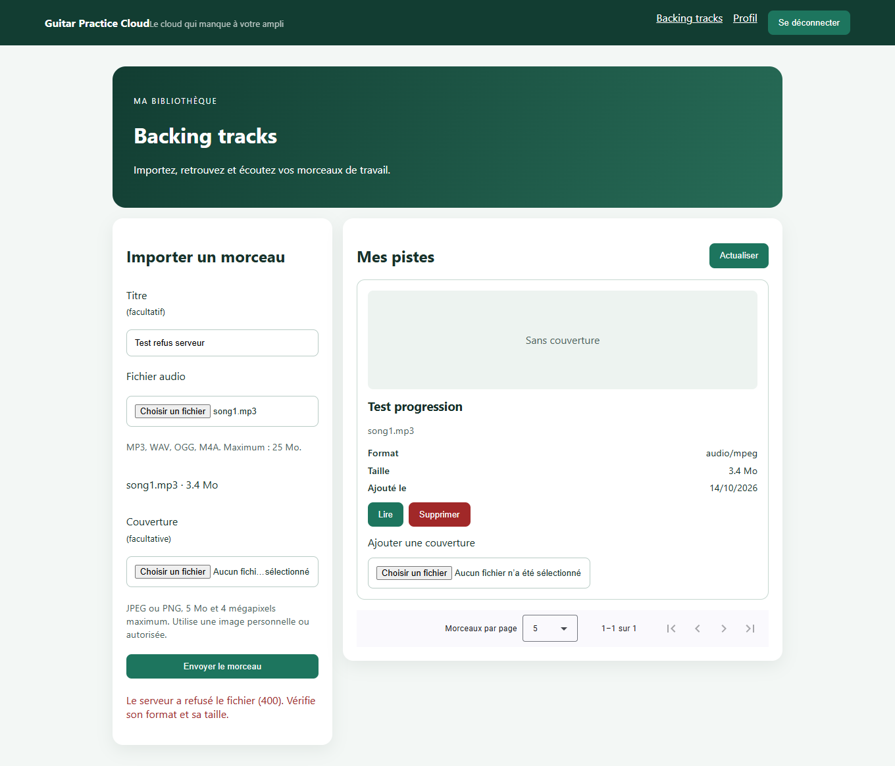

Le MIME du multipart a volontairement été modifié dans la requête de test pour provoquer un vrai refus 400 du backend. Cette capture ne représente pas un refus normal d'un MP3 valide. Le formulaire est redevenu disponible et la saisie a été conservée.

#### Pourquoi un upload avec progression ne se traite-t-il pas comme une réponse finale unique ?

Une requête observée sous sa forme habituelle fournit le corps de la réponse finale. Avec `observe: 'events'` et `reportProgress: true`, le même Observable peut émettre plusieurs étapes : envoi, progression, puis réponse. `withXhr()` dans `main.ts` fournit ici les événements de progression d'upload. Le composant examine `event.type` : `UploadProgress` actualise le pourcentage et `Response` confirme la réussite. Atteindre 100 % signifie que les octets ont été envoyés, mais le serveur peut encore traiter le fichier ou le refuser. Les journaux du composant conservent le statut HTTP, sans afficher de JWT ou de mot de passe.

### 4. Mission 7 — Tests automatisés

#### Fichiers et configuration

Six tests ont été ajoutés, sans remplacer les deux tests backend existants :

- `frontend-starter/src/app/shared/services/track.service.spec.ts` : pagination.
- `frontend-starter/src/app/shared/interceptors/auth.interceptor.spec.ts` : Authorization avec et sans token.
- `frontend-starter/src/app/components/tracks-page/tracks-page.spec.ts` : suppression, annulation et upload.

Vitest était déjà configuré. `jsdom` a été ajouté aux dépendances de développement pour simuler le DOM. La cible `test` de `angular.json` pointe vers `gpc:build` et `tsconfig.spec.json`, car aucune configuration de build nommée `development` n'existait. `tsconfig.app.json` exclut les fichiers `.spec.ts` du build applicatif. La commande start, la cible serve et le proxy restent inchangés.

`provideHttpClientTesting()` remplace le transport réseau. Les tests vérifient les URL, méthodes, paramètres, headers et réponses simulées avec `HttpTestingController`. Aucun backend ni MongoDB en fonctionnement n'est nécessaire. Le composant et TrackService sont réels ; les dialogues et le SnackBar sont remplacés par des doublures de test.

#### Rapport des tests — Résultats du 15 octobre 2026

| Test | Résultat attendu | Résultat observé |
| --- | --- | --- |
| Pagination | GET `/api/tracks?page=2&limit=5`, paramètres corrects et réponse transmise au souscripteur | Réussi |
| Intercepteur avec token fictif | Authorization Bearer ajouté sur une route protégée | Réussi |
| Intercepteur sans token | Aucun header Authorization | Réussi |
| Suppression confirmée | DELETE avec identifiant correct ; double clic bloqué ; après 204, GET de liste, liste vide et message SnackBar | Réussi |
| Suppression annulée | Aucun DELETE, piste conservée | Réussi |
| Upload | POST multipart avec audio/title ; 25 % pour 25/100 octets ; double envoi bloqué ; erreur 400 affichée et saisie conservée | Réussi |
| Backend existant : santé | GET health répond sans dépendre de MongoDB | Réussi |
| Backend existant : schémas | Vérifications des schémas Mongoose et de leur relation | Réussi |

**Bilan : 6/6 tests frontend, 2/2 tests backend.** Les ports 3000 et 4200 n'avaient pas de serveur applicatif à l'écoute pendant la validation des tests. L'extension backend facultative de la mission 7 n'a pas été réalisée.

**Difficultés et vérification des propositions IA :** les premiers essais de tests ont révélé une doublure SnackBar non utilisée et un sélecteur qui lisait une autre zone d'alerte. Les tests ont été corrigés avec `overrideProvider` et une recherche dans les zones d'alerte. Le code métier n'a pas été modifié pour faire passer les assertions. Les tests ne démontrent pas la sécurité réelle du serveur ni l'écriture des fichiers sur disque ; ces propriétés nécessitent des essais d'intégration.

### 5. Vérifications finales

Commandes exécutées depuis la racine du projet :

```powershell
npm.cmd --prefix frontend-starter test
npm.cmd --prefix backend test
npm.cmd --prefix frontend-starter run build
```

Les tests et le build ont réussi. Le démarrage avec `npm.cmd start` depuis `frontend-starter` a aussi été vérifié : page `/login` servie en HTTP 200, titre Connexion visible, aucune erreur JavaScript non interceptée lors de cette ouverture.

#### Suppression dans Network


Capture fournie par l'étudiant : méthode DELETE, domaine localhost:4200 et statut 204. Le cadrage ne montre pas le chemin complet ni la confirmation ; ceux-ci sont documentés par le code et les essais de mission 5.

#### Upload dans Network

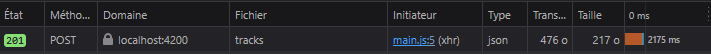

Capture fournie par l'étudiant : POST vers `tracks`, statut 201. La capture de progression de mission 6 complète cette preuve : la ligne Network terminée ne montre pas elle-même les événements Angular intermédiaires.

#### Console

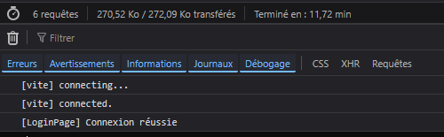

La portion visible contient les messages de connexion Vite et « Connexion réussie ». Aucune erreur ni valeur secrète n'est visible. Cette observation porte sur la capture fournie, pas sur tous les scénarios possibles de l'application.

### 6. Livrables TP3 — Dans l'ordre du sujet

| Livrable | Élément fourni |
| --- | --- |
| Suppression fonctionnelle | Mission 5 : confirmation, SnackBar, rechargement et gestion du 404 ; preuve Network 204. |
| Progression ou état d'upload | Mission 6 : pourcentage, blocage des contrôles, réussite et erreur ; captures associées. |
| Au moins trois tests frontend | Six tests dans trois fichiers `.spec.ts`. |
| Rapport des tests, attendu et observé | Tableau de la mission 7 ci-dessus. |
| Captures Network suppression et upload | Images DELETE 204 et POST 201 dans les vérifications finales. |
| Build exécuté | Compilation réussie le 15 octobre 2026. |
| Rapport IA | Présente section : demandes reformulées, réalisations, vérifications, difficultés et limites. |

